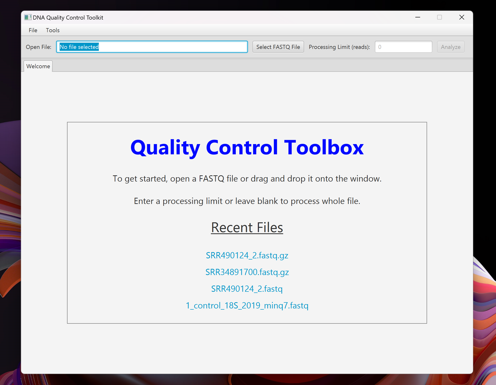
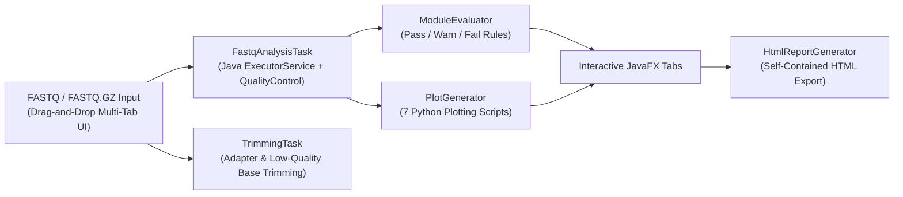

# DNA Quality Control Toolkit (QCToolkit)

[](https://openjdk.org/)
[](https://openjfx.io/)
[](https://www.python.org/)
[](LICENSE)

A FastQC-inspired desktop bioinformatics application built in Java 22, JavaFX, and Apache Maven for inspecting and trimming `.fastq` and `.fastq.gz` sequencing reads (tested on *E. coli* K-12 MG1655 `SRR490124`). Uses multi-threaded Java `ExecutorService` parsing paired with a Python plotting backend to generate 10 quality control visualisations and self-contained HTML reports.



## Architecture



## Key Features

- **Multi-Threaded FASTQ Parsing (`FastqAnalysisTask.java`, `QualityControl.java`):** Parses large `.fastq` and `.fastq.gz` read files on background threads (`ExecutorService` + JavaFX `Task`) without blocking the UI, with configurable read-preview limits.
- **10 Quality Control Charts (`PlotGenerator.java`, `scripts/`):** Bridges Java process execution with 7 Python scripts (Matplotlib, NumPy, Pandas, SciPy, Pillow) covering Per Base Sequence Quality, Per Sequence Quality Scores, GC Content, Sequence Duplication Levels, K-mer Content, and Adapter Content.
- **Adapter & Quality Trimming (`TrimmingTask.java`):** Trims low-quality bases and known adapter sequences (`adapter_list.txt`) directly inside the desktop workflow.
- **Self-Contained HTML Export (`HtmlReportGenerator.java`):** Packages all evaluated QC modules, tables, and rendered charts into a portable HTML report.

## Repository Structure

| Path | Description |
| :--- | :--- |
| `src/main/java/com/ahmed/App.java` | JavaFX application entry point. |
| `src/main/java/com/ahmed/QualityControl.java` | Core FASTQ metric aggregation engine. |
| `src/main/java/com/ahmed/FastqAnalysisTask.java` | Background multi-threaded parsing task. |
| `src/main/java/com/ahmed/TrimmingTask.java` | Quality and adapter sequence trimming task. |
| `src/main/java/com/ahmed/ModuleEvaluator.java` | FastQC-style pass/warn/fail threshold evaluator. |
| `src/main/java/com/ahmed/PlotGenerator.java` | Java-to-Python subprocess bridge for chart rendering. |
| `src/main/java/com/ahmed/report/HtmlReportGenerator.java` | Standalone HTML report builder. |
| `scripts/` | 7 Python plotting scripts generating all 10 QC charts and summary tables. |

## Setup & Running

### Prerequisites

- **JDK 22** (or newer)
- **Apache Maven**
- **Python 3.10+**

### Installation

```bash
git clone https://github.com/aahmeddev/QC-Toolkit.git
cd QC-Toolkit

# Create and activate Python virtual environment for plotting scripts
python -m venv python_env
# Windows:
python_env\Scripts\activate
# macOS / Linux:
source python_env/bin/activate

pip install -r requirements.txt
```

### Build & Run

Maven resolves JavaFX 24.0.1 automatically via `pom.xml`:

```bash
mvn clean javafx:run
```

## Acknowledgements

Inspired by [FastQC](https://www.bioinformatics.babraham.ac.uk/projects/fastqc/) from the Babraham Institute.

## License

Released under the [MIT License](LICENSE).
